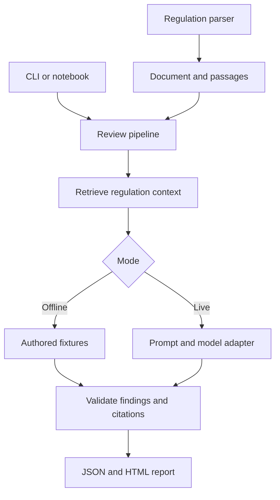

# Architecture and migration

## Scope of this change

The original MVP at commit `0562f75366bb733b337e8c5eae4f1bcb1e93f1ca` is preserved under `mvp_demo/`, including its generated notebooks, HTML, data, tests, source modules and documentation. Its files are unchanged; run old build commands from that directory. The new package does not import or execute archived application code in production. Regression tests use the archive as an independent oracle.

This is a modular baseline for retrieval-augmented generation, with lightweight lexical retrieval. It is not a deployment of Azure AI Search or a production regulatory knowledge store.

## Request flow



The offline fixture function validates its own output; the live path is validated by the pipeline. Both use the same validator. The compatibility `live_analysis()` entry point also validates model responses.

## Module boundaries

1. **Ingestion** turns a single regulation into `Document` and `Passage` objects. PDF extraction remains page-wise. Disclosure text is chunked during context preparation. No storage service is required.
2. **Retrieval** chooses regulation passages for the current claim batch. `Retriever.retrieve(document, claims)` can be replaced without changing the view or model adapter. The default selects all short documents and a lexical shortlist above 30,000 characters.
3. **Generation context** serializes only supplied claims, disclosure, selected regulation and metadata. Expected fixture answers are excluded. The original system prompt and user message serialization are preserved.
4. **Model transport** returns raw JSON. `Generator.generate(context, language)` permits an approved company SDK wrapper or test double. The existing transport keeps HTTPS checks, redirect refusal, timeout and response-size limits.
5. **Validation** checks one finding per claim, allowed statuses, and exact source quotations. A quote in an unselected passage cannot be cited. A valid quotation does not establish relevance or legal applicability.
6. **Reporting** assembles the existing JSON structure, counts, known-source arithmetic, warnings, fingerprint and escaped HTML. The timestamp is intentionally variable.
7. **Interfaces** collect inputs and delegate to `run_review()`. No RAG orchestration belongs in a notebook cell. UI settings are captured when the view is constructed; recreate the view after editing configuration.

The source contracts intentionally retain the original local `D0001`/`R0001` identifiers and dictionary report schema. Replacing them with corpus-wide identifiers is part of the proposed multi-regulation feature, not this parity refactor.

## Package usage

```python
from green_claims.demo.fixtures import load_cases, demo_regulation
from green_claims.pipeline import run_review

case = load_cases()[0]
report = run_review("\n".join(case["claims"]), case["disclosure"], demo_regulation())
```

Live mode:

```python
from green_claims.config import Settings

settings = Settings.from_env()
client = settings.make_client()  # Or settings.make_client(dbutils) in Databricks.
report = run_review(
    "\n".join(case["claims"]), case["disclosure"], demo_regulation(),
    "Live AI", generator=client, model=settings.model, language=settings.language,
)
```

For another retriever, pass `retriever=...` to `run_review()`. For another approved model client, pass an object implementing `generate(context, language)`. The validator still runs centrally. Invalid modes and Live AI without a generator fail explicitly; a model error never falls back to authored results.

Optional `verification="facts"` runs a separate fact-extraction prompt after the initial finding and then validates quotations and conditional arithmetic. `verification="facts_and_judge"` also runs a third model call for a separate opinion on factual and regulatory reasoning. Custom generators implement `extract_facts(context, language)` and optionally `judge(context, findings, fact_checks, language)`. Optional stage failures retain initial results with warnings. Details and limits: [fact verification](FACT_VERIFICATION.md).

## Migration map

| Former file | New ownership |
| --- | --- |
| `documents.py` | `models.py`, `text.py`, `ingestion/`, `retrieval/lexical.py`, `validation/citations.py` |
| `engine.py` | `pipeline.py`, `validation/findings.py`, `demo/fixtures.py`, `reporting/reports.py` |
| `ai_client.py` | `generation/prompts.py`, `generation/context.py`, `generation/client.py` |
| `render.py` | `reporting/html.py` |
| `notebook_ui.py` | `interfaces/notebook.py`, `config.py`, `pipeline.py` |
| Embedded application notebook | `notebooks/Green_Claims_RAG.ipynb` importing the package |
| Build scripts and original pitch assets | Preserved in `mvp_demo/` |

## Deliberately preserved limitations

Paragraph/character chunking has no overlap, hierarchy or table reconstruction. All claims share one regulation shortlist. Disclosure is included in full within its existing limit. No embeddings, reranker, OCR, persistent index, batch ETL, immutable audit storage, multi-document registry or automated temporal validity checking is implemented. A local FastAPI adapter and React interface are now available; see [web setup](WEB_APP.md). The baseline is deliberately small enough to evaluate each future change against known behavior.

The package includes only synthetic demo resources. Generated reports remain outside version control. The archive retains historical relative documentation and original GitHub URLs as evidence of the MVP; current entry points are linked from the root README.

## Web adapter

`interfaces/api.py` provides the web boundary. `frontend/` owns the React UI. The API invokes the same pipeline and returns source passages separately for inspection. See [WEB_APP.md](WEB_APP.md) for configuration, data flow, testing and deployment limitations.
